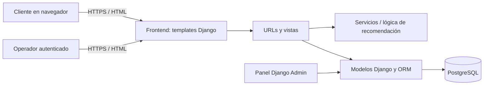
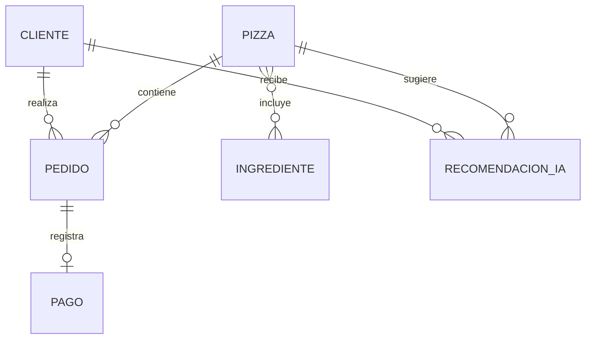
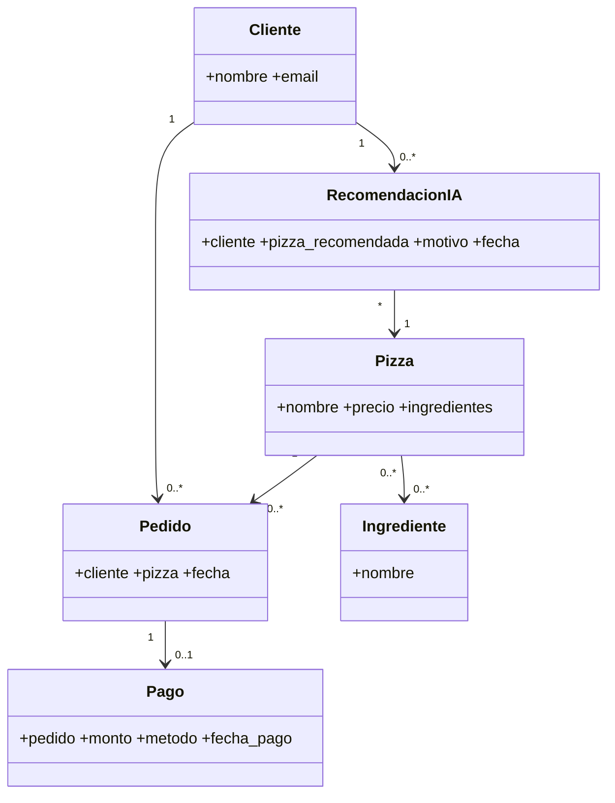

# 02 · Diseño de sistema y datos

## Arquitectura

La misma aplicación sirve frontend y backend. Las plantillas viven en `templates/`, las vistas y modelos en `pedidos_app/`, y la configuración en `pizia/`. No existe API JSON pública en esta versión. El ORM traduce operaciones a consultas parametrizadas. Las rutas de operación requieren sesión staff.

## Modelo entidad-relación

| Entidad | Atributos principales | Reglas |
| --- | --- | --- |
| Cliente | id, nombre, email | email único |
| Ingrediente | id, nombre | asociado a varias pizzas |
| Pizza | id, nombre, precio | relación muchos a muchos con ingrediente |
| Pedido | id, cliente, pizza, fecha | cliente y pizza obligatorios |
| Pago | id, pedido, monto, método, fecha_pago | un pago por pedido; actualmente no se procesa |
| RecomendacionIA | id, cliente, pizza_recomendada, motivo, fecha | historial/modelo disponible; el formulario actual no persiste recomendaciones |

## Clases principales

## Prototipos navegables

Los prototipos de alta fidelidad son las pantallas funcionales incluidas en `templates/`: inicio, catálogo, creación de pedido y recomendador. Flujos: cliente → “Nuevo pedido” → datos y pizza → confirmación; cliente → “PizIA recomienda” → preferencias/exclusiones/presupuesto → lista explicada; operador → iniciar sesión en `/admin/` → gestión. El catálogo de ejemplo se carga con `python manage.py seed_demo`.
